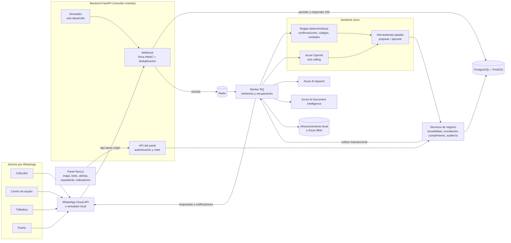
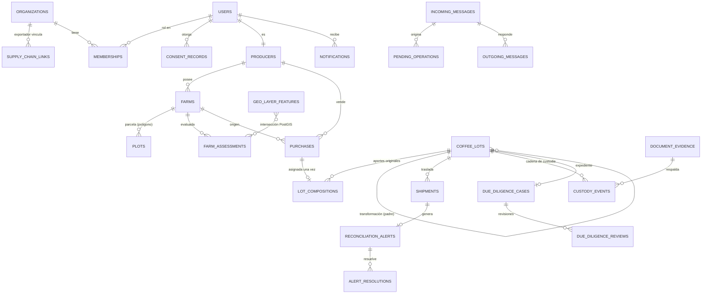

# Arquitectura

Monolito modular: un backend FastAPI, un worker RQ y un panel Next.js separado. PostgreSQL con PostGIS es la fuente de verdad. El LLM solo interpreta y propone herramientas; las reglas determinísticas y las restricciones de la base de datos protegen la integridad.

## Componentes

## Flujo de un mensaje

1. Meta (o el simulador) envía el webhook. Se verifica `X-Hub-Signature-256` con el secreto de la app.
2. El mensaje se persiste en `incoming_messages` con `ON CONFLICT DO NOTHING` sobre el identificador de WhatsApp (deduplicación) y se responde 200.
3. Se encola `process_incoming_message` en RQ con reintentos (5 s, 30 s, 120 s). Si el encolamiento falla, el mensaje queda persistido y el ciclo de recuperación del worker lo re-encola.
4. El worker toma un bloqueo consultivo por número (`pg_advisory_xact_lock`) y procesa los mensajes pendientes de ese número en orden de `message_timestamp`, lo que resuelve mensajes fuera de orden.
5. Descarga multimedia, transcribe notas de voz o extrae campos de fotografías y guarda el original con su SHA-256.
6. Las confirmaciones (`si`, `no`, `cancelar`, `SI OP-002`) se resuelven sin LLM. El resto pasa por el LLM con las herramientas que el rol del usuario permite.
7. Las herramientas de escritura crean una `PendingOperation` con un resumen. Solo una confirmación posterior al último resumen ejecuta la operación, con clave de idempotencia `pending:<id>`.
8. Las respuestas y notificaciones se escriben como `outgoing_messages` dentro de la misma transacción y se envían después del commit (outbox).

## Fechas

| Campo | Significado |
|---|---|
| `occurred_at` (eventos, compras) | Fecha de la actividad. Si la planilla tiene fecha del mismo día, se usa la hora del mensaje; si es de otro día, ese día a mediodía de Colombia. Nunca la fecha de recepción. |
| `message_timestamp` | Hora en que el usuario envió el mensaje (WhatsApp). |
| `received_at` | Hora en que el backend recibió el webhook. |
| `processing_started_at`, `processed_at` | Procesamiento en el worker. |
| `confirmed_at` | Confirmación de la operación por la persona autorizada. |

Todas las fechas se guardan en UTC y se presentan en hora de Colombia. Un evento no puede tener fecha anterior al último evento confirmado del lote (validación de cronología con resolución de un segundo).

## Fórmulas

- Diferencia de peso = peso despachado - peso recibido (positivo: faltante; negativo: excedente). Solo se calcula si el estado del café coincide.
- Porcentaje de discrepancia = diferencia / peso despachado x 100, con `Decimal`.
- Rendimiento de transformación = kg de salida / kg de entrada x 100 (952 a 714 kg: 75 %, supuesto sintético).
- Factor de rendimiento cafetero: kg de pergamino seco necesarios para obtener 70 kg de café excelso. Se registra como dato de la compra y no se mezcla con el rendimiento de transformación.
- Unidades: 1 arroba = 12,5 kg y 1 carga = 125 kg (configurables). Sacos y bultos no se convierten a peso.

## Modelo de datos

Restricciones relevantes:

- `purchases`: `available_kg` entre 0 y `net_weight_kg`; peso positivo; idempotencia única.
- `lot_compositions`: una compra solo puede estar en una composición (`UNIQUE(purchase_id)`); tabla de solo adición (trigger).
- `coffee_lots`: peso inicial positivo, peso actual no negativo, sin autorreferencia; ciclos bloqueados en el servicio.
- `shipments`: un solo traslado en tránsito por lote (índice único parcial); origen distinto de destino.
- `custody_events` y `audit_logs`: solo adición (trigger que rechaza UPDATE y DELETE).
- Índices espaciales GiST en ubicaciones, polígonos y capas.

## Seguridad

- Panel con JWT en cookie `httpOnly` (SameSite=Lax, Secure fuera de desarrollo) y contraseñas con bcrypt.
- Autorización por rol y por cadena (`supply_chain_links`): un exportador solo ve su cadena; recursos ajenos responden 404.
- El número de WhatsApp identifica el canal, no concede permisos: los operadores deben tener membresías previas. Teléfonos compartidos se resuelven preguntando con quién se habla.
- Herramientas filtradas por rol antes de mostrarlas al LLM y verificadas de nuevo en los servicios. El LLM no tiene acceso a SQL ni a la base de datos.
- Firma de webhooks, deduplicación, validación MIME y tamaño, límite de solicitudes, auditoría con identificador de correlación.
- Endpoints del simulador solo existen con `APP_ENV` de desarrollo y exigen sesión del panel.
- Todo texto saliente pasa por un filtro que elimina emojis y símbolos decorativos.
